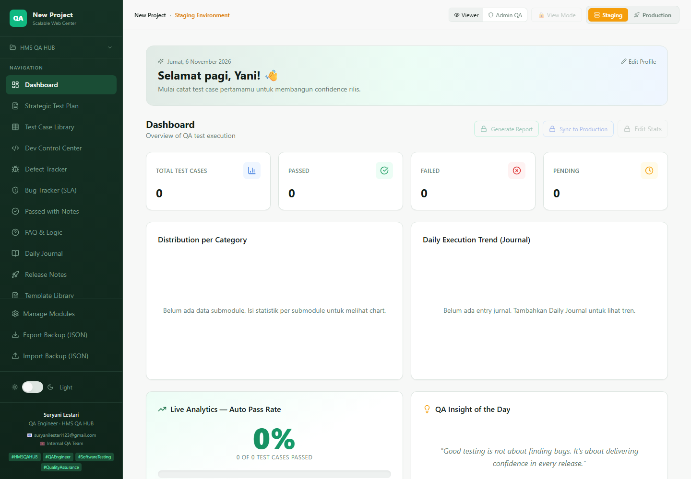

# HMS QA HUB

Internal QA management hub for test execution, defect tracking, and release governance — built for a hauling/logistics QA workflow and configurable for other projects.

[**Live demo**](https://hms-qa-hub-pro.vercel.app/) · [Test automation repo](https://github.com/sles1401/csm_test)



_Dashboard in its starter state. QA data is stored locally in the browser, per project and environment._

## Overview

HMS QA HUB centralizes the day-to-day work of a QA engineer: test execution stats, test assets, defects, release notes, audit history, and reporting. It runs as a local-first React application, so the hub works without a backend while keeping project data separated by environment.

The app ships with a hauling management module structure (Master Data and Hauling Management) that can be renamed, extended, or replaced from **Manage Modules**.

## Features

| Area | What it does |
|---|---|
| **Dashboard** | KPI cards, auto pass rate, category distribution, daily execution trend, release deadline alerts, and URL health monitoring |
| **Test assets** | Strategic Test Plan and Test Case Library embedded from Google Docs/Sheets, template library, and Figma links |
| **Defect management** | Defect tracker, SLA-aware bug tracker, and a passed-with-notes log for non-blocking findings |
| **QA workflow** | FAQ & logic Q&A, daily journal, release notes, and a Dev Control Center for incoming developer reports |
| **Audit & traceability** | Audit trail with manual/sync/health-check/import sources, JSON and CSV import, CSV diff export, and PIN-protected Admin Mode |
| **Projects & environments** | Create, duplicate, and delete projects; keep separate staging and production configs; sync passed results to production |
| **Reporting** | PDF report generation with editable logo, heading, and footer; Excel export; configurable pass-rate regression thresholds |
| **Access & vault** | Admin QA and Viewer roles, user management, Supabase authentication, and a private document vault protected by row-level security |

## Tech stack

| Layer | Technology |
|---|---|
| UI | React 18, Vite 5, TypeScript |
| Styling | Tailwind CSS, shadcn/ui, Radix UI, Lucide icons |
| Charts | Recharts |
| Forms & validation | React Hook Form, Zod |
| Data | Browser `localStorage` for QA data; TanStack Query |
| Auth & storage | Supabase Auth and private storage (RLS) |
| Export | jsPDF + jspdf-autotable, SheetJS (`xlsx`) |
| Testing | Vitest, Testing Library, Playwright |
| Deployment | Vercel |

## Architecture

```text
React SPA
├── localStorage
│   ├── projects & active project/environment
│   ├── per-project, per-environment QA config
│   └── admin PIN and local settings
└── Supabase
    ├── Auth (login for the document vault)
    └── private-vault bucket + user_documents table (RLS)
```

QA data never leaves the browser unless you export a backup. Supabase is used only for authentication and the private document vault.

## Getting started

### Prerequisites

- Node.js 18 or newer (Node 20+ recommended)
- npm
- A Supabase project — required for `/auth` and `/vault`; the dashboard itself runs without it

### Installation

```bash
git clone https://github.com/sles1401/hms-qa-hub-pro.git
cd hms-qa-hub-pro
npm install
```

Create a `.env` file in the project root (replace the existing demo values if needed):

```ini
VITE_SUPABASE_URL=https://your-project.supabase.co
VITE_SUPABASE_PUBLISHABLE_KEY=your-publishable-key
VITE_SUPABASE_PROJECT_ID=your-project-ref
```

Only the publishable (anon) key belongs in the client. Never put a `service_role` key in a Vite environment variable.

Run the app:

```bash
npm run dev
```

Open the URL printed by Vite, then use **New Project** in the sidebar to start a workspace. Data is saved automatically to `localStorage`.

### Supabase setup

For the vault feature, apply the migration in [`supabase/migrations`](supabase/migrations/) to your project. It creates the `user_documents` table, enables row-level security, and adds the private `private-vault` storage bucket with per-user policies.

## Available scripts

| Command | Description |
|---|---|
| `npm run dev` | Start the Vite dev server |
| `npm run build` | Production build to `dist/` |
| `npm run build:dev` | Development-mode build |
| `npm run preview` | Preview the production build |
| `npm run lint` | Run ESLint |
| `npm test` | Run Vitest once |
| `npm run test:watch` | Run Vitest in watch mode |

Playwright configuration and a shared fixture are included for E2E scaffolding.

## Project structure

```text
src/
├── components/          # Feature tabs, dialogs, sidebar, UI primitives
├── hooks/               # Role, URL health, health log, debounce
├── integrations/
│   └── supabase/        # Supabase client
├── lib/                 # Store, reports, admin settings, user management
├── pages/               # Index, Auth, Vault, NotFound
└── test/                # Vitest setup and example test
supabase/
├── config.toml
└── migrations/          # Vault schema, RLS policies, storage bucket
docs/
└── screenshots/
```

## Data and privacy

- QA data is stored in `localStorage` keys such as `hms-qa-hub-config-<project>-<environment>`.
- Use **Export Backup (JSON)** in the sidebar before clearing the browser or moving to another machine.
- The vault stores files in Supabase Storage under the user's ID; RLS prevents access to other users' documents.
- The admin PIN is stored locally in the browser and is not a replacement for server-side authorization.

## Deployment

The demo is deployed on Vercel. For your own deployment, import the repository, set the three `VITE_SUPABASE_*` environment variables, and use the default Vite settings:

- Build command: `npm run build`
- Output directory: `dist`

## Author

**Suryani Lestari** — QA Engineer, Bandung, Indonesia

[GitHub](https://github.com/sles1401) · [Linktree](https://linktr.ee/sles1401)
